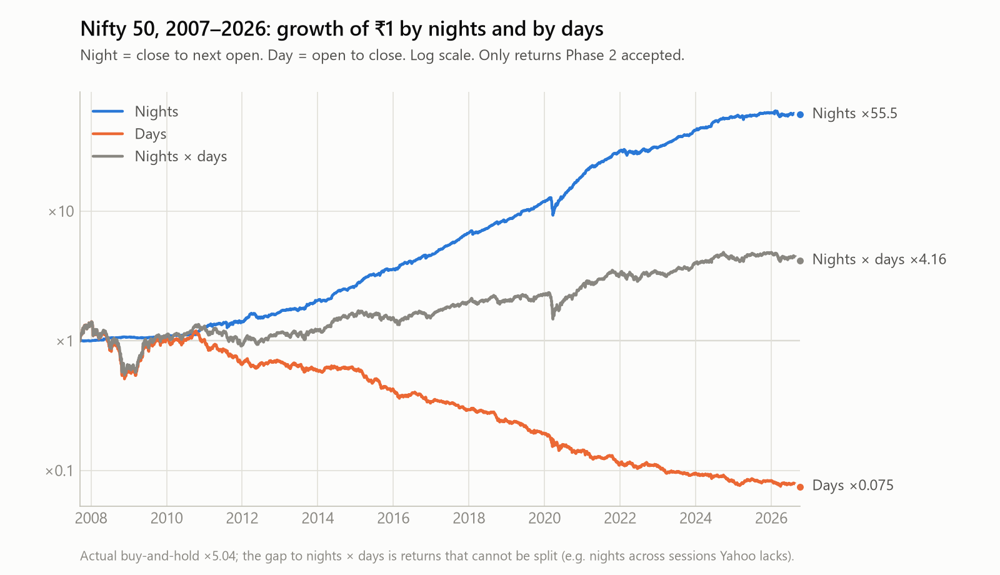
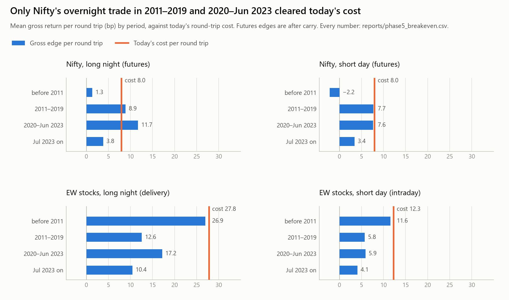
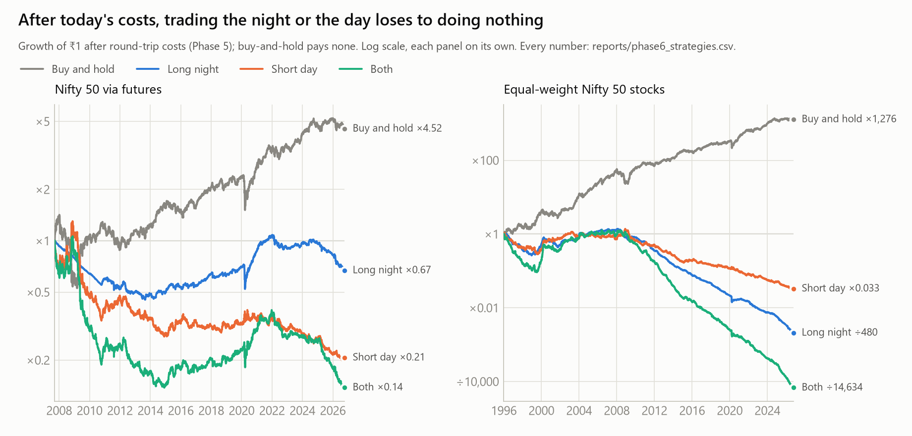

# Overnight drift in Indian stocks: what the data says

*Generated by `python -m scripts.phase7_findings`. Every result below is filled in from the CSVs in this folder, and every method setting from `src/config.py`, so a rerun updates them. Data to {{data_last}}. The method, phase by phase, is in [`PLAN.md`](../PLAN.md).*

## The short answer

A short video described an observation by the physicist and former quant Bruce Knuteson: US stocks make their gains overnight and lose ground during trading hours. **Indian stocks show the same split, and strongly.** Since {{nifty_first_year}}, ₹1 in the Nifty 50 held only overnight (close to the next open) grows {{nifty_night_x}}. Held only during trading hours, it ends {{nifty_day_x}}. Every one of the {{n_stocks}} current Nifty 50 stocks shows the pattern.

**The split is real, but you can't trade it.** After today's Indian trading costs, every way of trading it has lost money since July 2023. Over the whole sample, the Nifty and stock versions lose to simply holding; the one paper exception, Sensex, is discussed below. What's left is free and small. For a monthly investment, buying at the close rather than with an order that waits for the next morning's open is worth {{sip_nifty_next_bp}} bp per instalment on Nifty and {{sip_stocks_next_bp}} bp on the median stock.

## What was measured

- **The series.** {{n_series}} daily series: the Nifty 50, Sensex and Nifty Bank indices, the NIFTYBEES ETF, and the {{n_stocks}} current Nifty 50 stocks. They run from {{stock_first}} to {{data_last}}.
- **Night and day.** A **night** is the previous close to today's open; a **day** is today's open to today's close. A night followed by its day is exactly what holding earns.
- **The data.** Prices come from Yahoo Finance, checked against NSE's own daily files. After cleaning, {{usable_nights}} usable nights remain. {{spot_match_pct}} of {{spot_nights}} randomly sampled nights matched NSE's official prices to within {{spot_tolerance}}.

## 1. The split exists

| | Nights only | Days only | Mean per night | Mean per day |
|---|---|---|---|---|
| Nifty 50, {{nifty_first_year}} on | {{nifty_night_x}} | {{nifty_day_x}} | {{nifty_night_bp}} bp | {{nifty_day_bp}} bp |
| Sensex, {{sensex_first_year}} on | {{sensex_night_x}} | {{sensex_day_x}} | {{sensex_night_bp}} bp | {{sensex_day_bp}} bp |
| {{longest_stock_name}}, {{longest_first_year}} on | {{longest_night_x}} | {{longest_day_x}} | {{longest_night_bp}} bp | {{longest_day_bp}} bp |



- **Every stock shows it.** Nights beat days for {{stocks_night_beats_day}} of the {{n_stocks}} stocks, and {{stocks_day_negative}} of them lose money during the day; the exception is {{stocks_day_nonnegative}}. The median stock makes {{stock_median_night_bp}} bp a night and {{stock_median_day_bp}} bp a day. All 50 are in [`figures/phase3_stocks.png`](figures/phase3_stocks.png).
- **Weekend nights don't earn more than weeknights.** Nifty earns {{nifty_weekend_bp}} bp over a weekend against {{nifty_weeknight_bp}} bp on a weeknight; the stocks earn {{stocks_weekend_bp}} against {{stocks_weeknight_bp}}. If the night return were pay for holding risk while the market is shut, a three-day night should earn more.

## 2. It is not noise, but it is fading

The **gap** is night minus day on the same date, in bp per session. Each gap has a Newey-West t-statistic (above about 2 means unlikely to be chance), which allows for daily returns being correlated:

| Period | Nifty 50 | Equal-weight stocks |
|---|---|---|
| Full sample | **{{nifty_gap_full}}** (t {{nifty_gap_t_full}}) | **{{ew_gap_full}}** (t {{ew_gap_t_full}}) |
| Before 2011 | {{nifty_gap_pre_auction}} (t {{nifty_gap_t_pre_auction}}) | {{ew_gap_pre_auction}} (t {{ew_gap_t_pre_auction}}) |
| 2011–2019 | {{nifty_gap_2011_2019}} (t {{nifty_gap_t_2011_2019}}) | {{ew_gap_2011_2019}} (t {{ew_gap_t_2011_2019}}) |
| 2020–Jun 2023 | {{nifty_gap_covid_retail}} (t {{nifty_gap_t_covid_retail}}) | {{ew_gap_covid_retail}} (t {{ew_gap_t_covid_retail}}) |
| Jul 2023 on | {{nifty_gap_gift_nifty}} (t {{nifty_gap_t_gift_nifty}}) | {{ew_gap_gift_nifty}} (t {{ew_gap_t_gift_nifty}}) |

- **The night is the stronger half.** Over the full sample, Nifty's nights average {{nifty_night_bp}} bp (t {{nifty_night_t}}) and its days {{nifty_day_bp}} bp (t {{nifty_day_t}}). The 95% bootstrap interval for its gap is {{nifty_gap_ci}} bp.
- **It holds stock by stock.** {{stocks_gap_t2}} of {{n_stocks}} stocks have a significant gap. {{stocks_gap_bonf}} still pass after correcting for running {{stock_tests}} tests (\|t\| > {{bonferroni_t}}). None has a significantly negative one.
- **It is shrinking.** Since July 2023, Nifty's gap is {{nifty_gap_gift_nifty}} bp and only {{stocks_gap_t2_latest}} of {{n_stocks}} stocks still clear t > 2. Nifty Bank's gap is {{bank_gap_latest}} bp (t {{bank_gap_t_latest}}), no longer significant. That month SGX Nifty moved to GIFT City as GIFT Nifty, which trades through most of the Indian night. The timing fits, but it doesn't prove the cause.
- **It has nothing to do with liquidity.** Spearman ρ between a stock's traded value and its gap is {{liquidity_rho}} (permutation p = {{liquidity_p}}).
- **Before 2011, Nifty shows no gap.** That window is short (2007–2010, with the 2008 crash in it). Stock opens were also set differently then: before NSE's pre-open auction began in late 2010, a stock's open was its first trade.

## 3. It does not survive Indian trading costs

A strategy that holds only overnight, or only intraday, trades every session: about {{round_trips_per_year}} round trips a year. One round trip costs, at today's rates (checked {{rates_checked}}; slippage of {{slippage_range}} bp a side included):

| Trade | Round trip | Of which STT |
|---|---|---|
| Stock held overnight (delivery) | {{cost_stock_delivery}} bp | {{stt_stock_delivery}} bp |
| Stock bought and sold the same day | {{cost_stock_intraday}} bp | {{stt_stock_intraday}} bp |
| Nifty futures | {{cost_futures}} bp | {{stt_futures}} bp |



- **Nifty, overnight via futures.** At today's costs this made {{nifty_s1_net_2011_2019}} a year in 2011–2019 and {{nifty_s1_net_covid_retail}} in 2020–Jun 2023. Both are less than just holding ({{nifty_hold_2011_2019}} and {{nifty_hold_covid_retail}}). Since July 2023 it returns {{nifty_s1_net_gift_nifty}} a year, against {{nifty_hold_gift_nifty}} for holding: the futures STT alone ({{stt_futures}} bp) is now bigger than the night's whole edge ({{nifty_gross_gift_nifty}} bp).
- **Stocks, overnight.** Delivery STT alone ({{stt_stock_delivery}} bp) is more than the median stock's night ({{stock_median_night_bp}} bp). Equal-weight stocks return {{ew_s1_net_full}} a year over the full sample and {{ew_s1_net_gift_nifty}} since July 2023. {{stocks_s1_positive_full}} of {{n_stocks}} stocks make money over the full sample, and {{stocks_s1_positive_gift_nifty}} since July 2023.
- **Shorting the day instead** is cheaper (intraday STT is a quarter of delivery's), but the edge is smaller too: equal-weight stocks return {{ew_s2_net_full}} a year.
- **Before costs, holding only overnight looked excellent.** Nifty gross is {{nifty_s1_gross_full}} a year against {{nifty_s0_full}} for holding, with a return-to-volatility ratio of {{nifty_s1_retvol_gross}} against {{nifty_s0_retvol}}. After costs it ends at {{nifty_s1_net_full}} a year.



## 4. What is left, for free

Trading at a different time of day, with the same trades, costs nothing extra. For a monthly SIP:

| Buying at the close instead of... | Nifty: per instalment, final value | Median stock | Close wins for |
|---|---|---|---|
| the next morning's open (an order placed in the evening) | {{sip_nifty_next_bp}} bp, {{sip_nifty_next_pct}} | {{sip_stocks_next_bp}} bp, {{sip_stocks_next_pct}} | {{sip_stocks_next_wins}} of {{n_stocks}} stocks |
| that same morning's open | {{sip_nifty_open_bp}} bp, {{sip_nifty_open_pct}} | {{sip_stocks_open_bp}} bp, {{sip_stocks_open_pct}} | {{sip_stocks_open_wins}} of {{n_stocks}} stocks |

**Don't let a buy order wait overnight for the next morning's open.** Against that same morning's open it is a coin-flip. Index funds already buy at the close (same-day NAV), so this matters for direct stock orders.

## Things that looked like findings and weren't

- **The Nifty ETF's "edge".** NIFTYBEES opens far above where the index opens: the median gap in 2021 was {{etf_gap_2021_bp}} bp a night. Traded naively, that would "earn" {{etf_s1_net_full}} a year after costs. NSE's official prices agree with Yahoo's, so this is the ETF's real opening print. But daily data can't show whether anyone could sell there in size, so treat it as an open question, not a result.
- **Sensex beats Nifty overnight.** Sensex's night is consistently bigger than Nifty's: {{sensex_night_2011_2019}} vs {{nifty_night_2011_2019}} bp a night in 2011–2019. On paper, that makes its overnight trade beat holding in that period ({{sensex_s1_net_2011_2019}} vs {{sensex_hold_2011_2019}}). The two indices share most of their stocks, so the difference most likely comes from how BSE sets the index's opening value. That isn't checked here (no BSE data is used), and Sensex futures trade far less than Nifty futures.
- **Sessions Yahoo doesn't have.** NSE traded on {{hidden_sessions}} days that appear in no Yahoo series, mostly special Saturday sessions, Budget days and Diwali Muhurat sessions. A "night" across one of them contains a whole trading day. They were found by asking NSE's archive about {{nse_verdicts}} dates.
- **Placeholder rows.** Yahoo fills NSE holidays with flat rows at the previous close, which look like zero-return nights and days. {{placeholder_rows}} were removed.
- **Mis-scaled dividends.** For {{bad_dividend_series}} stocks, Yahoo kept dividends that were never adjusted for later splits, some larger than the share price itself. That made their adjusted prices negative. Those series now start after their last such dividend.
- **Freak opening prints.** On some days a stock opens more than {{reversed_jump}} away and gives it all back by the close. NSE's own records confirm {{reversed_confirmed}} of them, so they are real prints and stay in the data, flagged.

## Caveats

- **Survivorship.** Only today's Nifty 50 constituents are included. That flatters buy-and-hold more than it affects the night/day split, but the split is still only measured on survivors.
- **No intraday data.** Only daily open and close are used. Whether NIFTYBEES's open could be traded in size is untested.
- **Index futures are modelled, not observed.** They are the index's own night, less the cost of carry (about {{futures_carry}} a year); no futures prices are used.
- **Costs are today's**, applied to every year. Tax, interest on idle cash, margin and price impact in the opening auction are not modelled.
- **Remaining data errors.** An earlier spot-check found a handful of genuine Yahoo errors that no check catches, so expect a small residual error rate.

## Reproduce

```
python -m scripts.phase1_acquire       # download (network; Yahoo and NSE)
python -m scripts.reproduce            # phases 2-7 in order, from the cache
python -m pytest
```
